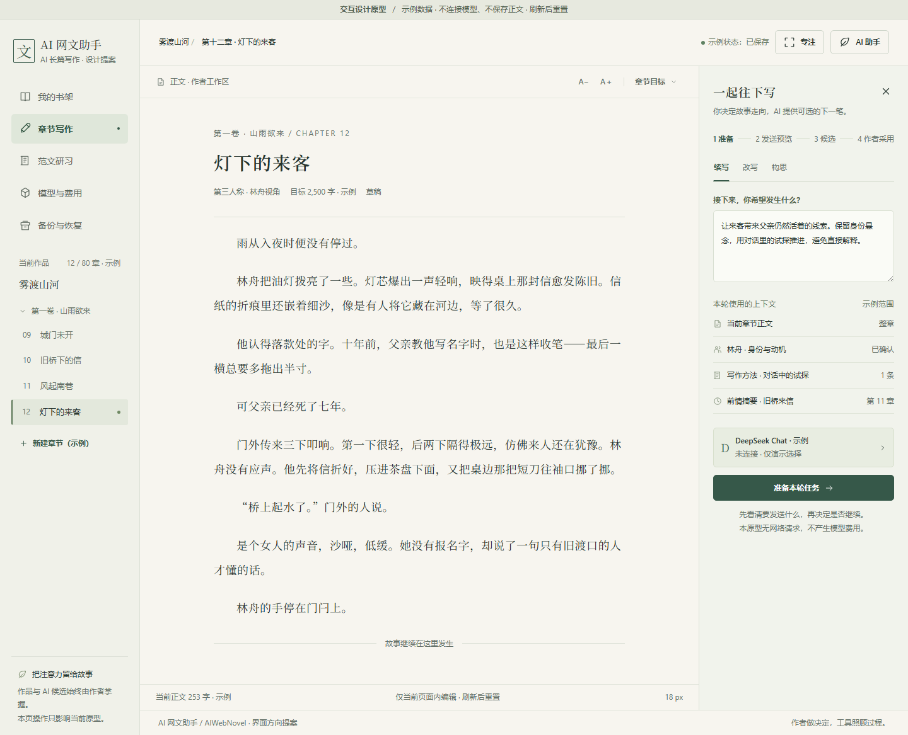

# 产品改进与 UI 交接包

2026-10-22。目标：让作者更容易持续写完长篇小说，并让接手 AI 按明确范围实现功能，不重新阅读整个项目历史。

**更新：2026-10-26。A1/A2/B1/B2/C 已实现并合并到 main（PR #35），Windows Default/Full CI 通过。** 设计原型仍只是原型；当前能力与证据以 [PLAN](../../PLAN.md) 为准。D 高开发量功能按作者要求完成可领取规格：[D 阶段实现交接](D_IMPLEMENTATION_HANDOFF.md)。D/E 尚未实现。
## 从这里读，按需展开

| 文件 | 用途 |
| --- | --- |
| [功能设计](FUNCTION_DESIGN.md) | 缺少什么、为什么做、数据与接口建议、边界、验收条件、开发及运行 token 成本分级 |
| [操作流程](WORKFLOW_DESIGN.md) | 当前流程问题与优化后步骤，模型、范文、生成、评审及恢复的具体状态与失败处理 |
| [界面规格](UI_DESIGN.md) | 页面结构、布局、视觉 token、响应式、无障碍及源码对照 |
| [交互原型](ui-prototype.html) | 可离线打开的五屏样稿；全部是内存中的示例数据，无模型调用、无 API Key、无正式正文 |

初次接手只读 `AGENTS.md`、`PLAN.md`、本页，再读领取任务对应的规格和模块；不展开 `docs/history/`、旧验收轮次和全量 Issue 评论。原型无需 npm 安装、构建或联网，下载后用浏览器打开即可。

原型可演示五屏导航、准备/确认/候选采用、范文方法应用、示例模型选择、费用算术、恢复副本提示和专注模式。完整评审面板、冲突合并、全书时间线等仍是文档规格，不把局部原型当成完整产品。



另见 [范文对照界面预览](ui-study-preview.png)。这是本地原型的截图，正式应用已有 A1 工作台；该图片仅作设计参考。

## 当前事实与不能混淆的状态

- 已有真实功能：小说/设定/人物/卷章、正文自动保存与修订历史、TXT 导出、模型配置、冻结上下文、持久候选和作者采用、范文对照分析与规则版本、章节规划、带来源版本的事实确认、有限跨章召回和评审。
- RF-15 备份及 RF-16 工程规模评测已通过 PR #33 合并，具有 Windows 本地证据。本轮设计核对的产品代码为 `57ed00f2d8e982915641d12a5a5bcb0736d1e39c`，设计分支已同步主干 `b1ac8a4f064dd6a5c041e9e672bc987670c786ed`；期间主干只增加合并与状态文档，产品源码一致。
- 已有召回最多 24 条 / 10,000 字符，任务上下文总预算 60,000 字符；当前不是全书事实覆盖。现有连续生成最多 10 步 / 3,000 字，不等于自动写完整章或全书。
- 工程样本约 11.3 万字不证明文学质量；真实 DeepSeek 的付费输出、实际账单与作者质量评价仍未验证。
- 历史反馈中的“模型保存后选不了”“发送后没有反馈”已有修复逻辑。本轮改进其入口与状态呈现，不能凭旧反馈宣布当前故障复现。

## 推荐实施顺序：每次完成一条作者闭环

| 交付包 | 完整成果 | 开发量 | 额外模型调用 | 本轮状态 |
| --- | --- | --- | --- | --- |
| A · 作者工作台 | 作者首页、书架、卷章导航、三栏写作与专注模式、固定状态区、原地模型设置 | 中；复用现有 API，先不换编辑器 | 无 | A1/A2 已合并，剩余项见 AB_FOLLOWUPS |
| B · 候选处理与用量控制 | 可靠的生成反馈、原文/候选对照、明确采用；真实 usage 记录与调用前预算 | 中到大；新用量与候选编辑能力需持久化契约 | 只记录已有请求不增加调用；连接测试需作者主动触发 | B1/B2 已合并，剩余项见 AB_FOLLOWUPS |
| C · 长篇故事控制 | 全书/卷级规划、伏笔/时间线、可调召回与来源失效复核 | 大；新增实体、版本、检索与预算策略 | 人工录入/筛选为零；AI 分析按需增量 | C 首版已合并；缺口见 PLAN |
| D · 跨章与资料交接 | 有界任务队列、旧稿导入、可携带上下文与版本的外部 AI 交接包 | 大；数据导入、恢复与幂等复杂 | 导入文本不调用模型；生成队列须预估并由作者限额 | 已拆为 D1/D2/D3 可领取规格，尚未实现 |
| E · 方法效果验证 | 方法适用范围、作者评分、可选 A/B 试写、跨书方法模板 | 中到大；沿用规则与候选版本 | 人工比较为零；可选试写明确增加两次生成 | 仅设计，后置 |

开发量是相对复杂度，不是工期或 token 报价。优先完成 A，再处理 B；C 内先规划/伏笔，再增强召回；D 的自动批量生成依赖真实用量记录和可靠召回，不能抢先做“自动写一整本”。E 在账本与候选隔离就绪后实施。不要求每个内部小项都让作者再说一次“继续”。

下面是功能编号与流程编号的排期映射。A1–C 已交付；接续从 D1 旧稿导入开始，按包领取，避免同时改写所有模块。

| 实施范围 | 功能编号 | 流程编号与边界 |
| --- | --- | --- |
| A1：现有能力重新布局 | F01 入口部分 | WF-01 基础导航/状态，WF-02，WF-03 布局部分，WF-04 范文捷径；复用现有 API，不显示无数据支持的总字数/待办数字 |
| A2：工作台汇总 | F01 派生读模型与作者定稿状态 | WF-01 汇总部分、WF-05；在 A1 后接分页汇总 API，不下载所有正文统计 |
| B1：候选对照与可见用量 | F01-B 只读 diff、F06 账本 | WF-03 差异部分；先显示已有结果与未知用量，零额外模型调用 |
| B2：候选编辑与可靠保存 | F01-B 作者编辑修订、F06 预算 | WF-06 冲突/本机草稿恢复；需新持久化及隔离契约，不算样式小改 |
| C：长篇故事控制 | F02、F03、F04 | WF-09 的本地检索/固定/排除先做；语义索引、多轮评审后置，不属于首版验收 |
| D：跨章与资料交接 | F05、F07 | WF-08；WF-07 恢复记录作为独立零模型调用小闭环，可先交付，不阻塞旧稿导入 |
| E：写作方法验证 | F08 | 方法适用条件、作者评分先做；两次对照生成由作者显式选择 |

现在不优先做：多人协作、云同步、插件市场、自动发布平台、花哨关系图、向量库/多代理常驻讨论。它们会增加同步、安全或反复调用成本，当前作者闭环收益不足；以后有实际需求再开具体范围。

## 交给其他 AI 的任务模板

当前接续使用 [D1 可复制任务](D_IMPLEMENTATION_HANDOFF.md#可直接交给下一位-ai-的任务)。以下 A 示例仅供模板格式参考，不代表 A 尚未实现。

将下面模板中的“交付包”替换为上表一个包；C/D 内按功能规格中的依赖选择一个完整闭环，避免一次横跨所有新实体。

```text
请在 AI-Writer-project 实施“交付包 A：作者工作台”。
先核对 GitHub main、PR #33 和 codex/product-experience-design 的最新 head，
读取 AGENTS.md、PLAN.md、docs/product/README.md，
再按需读取 FUNCTION_DESIGN.md、WORKFLOW_DESIGN.md、UI_DESIGN.md。
docs/product/ui-prototype.html 是交互和视觉参考，不是生产实现，不得复制演示业务状态。

PR #33 已合并；以最新 main 或包含本设计包的分支作为基础，避免使用旧候选分支。
复用现有 API、不可变修订、冻结上下文和作者确认契约。
只实现本次交付包；大功能未接线前不显示为可用，不重做已实现模块。
先完成真实作者操作链，再验证失败/刷新/旧版本/重复点击的处理。
测试仅用自有隔离根，不读取正式作者数据、备份或密钥。
按仓库规则运行受影响检查及提交前一次完整 IncludeE2E；记录精确 SHA 与真实限制。
更新本轮任务和 PLAN，保留失败证据，不增设循环验收或重复确认停点。
普通提交与推送按本次用户授权执行；没有授权则不擅自合并、发布或调用付费模型。
```

模型调用节省要求：纯导航、搜索、统计、排序、差异比较、格式校验均在本地完成；只有作者明确要求分析/生成/评审时调用模型。复用有效分析与来源版本；源文变化只使相关结果过期，不后台全书重跑。每个新任务冻结实际发送内容；摘要压缩也计入调用账本，不把它称为免费。

## 本轮验收范围

设计文档之间的功能范围、依赖、现状与术语应一致；原型要实际点击验证主导航和生成确认链，并检查桌面/窄屏布局、键盘操作、控制台异常和外部网络请求。结果记录在 GitHub 设计任务与 PR。产品源码不变时沿用 `57ed00f` 对应 Windows 验收证据，不为文档重跑整套产品门禁，也不把原型测试冒充产品验收。

2026-10-22 原型检查：Chromium 105 项断言通过，五屏在 360/390/768/1024/1440 px 均无页面横向溢出；生成确认与采用、撤销、范文方法、模型自动选用、备份示意、刷新重置、专注退出、抽屉焦点/背景隔离均通过。未发起网络请求，浏览器错误为零。随后仅修正备份说明为“不含模型配置及 Key”，专项核对该文案及布局。原型演示通过不证明新界面已接入产品。
